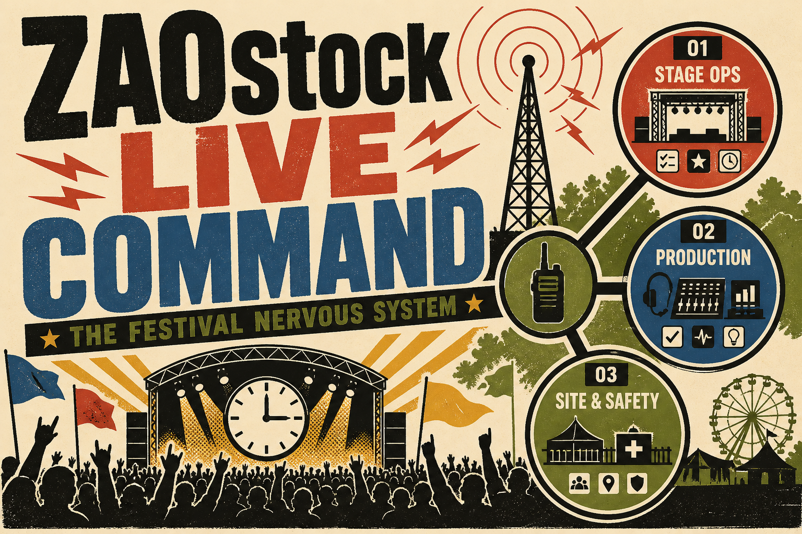

# ZAOstock Live Command



ZAOstock Live Command is a live event operating room: one shared event Reality for stage, crew, WaveWarZ, organizers, and community agents. ZAOstock is scheduled for October 3, 2026 at Franklin Street Parklet in Ellsworth, Maine.

The finals build proves four things:

1. **Live Command** turns a run-of-show into NOW/NEXT, event clock, Pulse, and system status.
2. **Hermes Conductor** detects anomalies and calculates bounded recovery options.
3. **Three focused minions** own Stage, Crew, and WaveWarZ state without pretending to be a room full of chatbots.
4. **Rehearsal/Chaos Mode** lets judges break the festival before the crowd arrives.

## Surfaces

| Surface | Route | Purpose |
|---|---|---|
| Command | `/` | Festival control room, Pulse, Hermes, chaos injection |
| Program | `/program` | Editable run-of-show, reordering, and substitutions |
| Staff | `/staff` | Roles, shifts, assignments, and check-ins |
| Work | `/work` | Human and agent work in queue, active, blocked, proof, and done |
| Marketing | `/marketing` | Signal drafts from shared event Reality; no automatic publishing |
| Connect | `/connect` | Scoped handoff to ZOE, ZABAL Bot, Zaal's agent, or custom workers |
| Team | `/team` | Owner bootstrap and one-time role-scoped admin invites |
| Crowd | `/crowd` | No-login NOW/NEXT, program, WaveWarZ, participation |
| Crew | `/crew` | Check-in, assignments, bounded Hermes requests |
| Replay | `/replay` | Flight recorder and candidate lessons |
| Developers | `/developers` | Agent API and authority model |

## Authority model

- **Level 1, observe:** timers, drift, crew coverage, battle state, displays.
- **Level 2, reversible:** task claims, internal notifications, countdowns, rehearsal failover.
- **Level 3, human gate:** critical schedule changes and consequential public effects.

Rehearsal events are explicitly returned as `SIMULATED`. The app does not claim that demo activity occurred at a real festival.

## Agent API

```bash
curl https://zaostock-live-command.pages.dev/api/v1/state

curl -X POST https://zaostock-live-command.pages.dev/api/v1/ask \
  -H "content-type: application/json" \
  -d '{"question":"Are we ready for WaveWarZ?"}'
```

Agent onboarding is available at `/connect`; bearer-authenticated agents orient through `/api/v1/agents/context`. OpenAPI: `/api/openapi.json`.

## Local development

```bash
npm install
npm run db:migrate:local
npm run dev
```

Verification:

```bash
npm run check
npm test
npm run build
```

## Cloudflare

The application targets Cloudflare Pages with a D1 binding named `DB`. Schema migrations live in `migrations/`.

```bash
npm run db:migrate:remote
npm run deploy
```

## Mini-app discovery

- Open Graph, Twitter/X, PWA, and standard web discovery metadata are included.
- Farcaster embed metadata and `/.well-known/farcaster.json` are included.
- Calling `sdk.actions.ready()` removes the Farcaster launch splash when hosted inside a mini app.
- The domain owner must add a signed Farcaster `accountAssociation` after deployment.
- Base discovers the same app as a standard web app; Base.dev registration requires the owner's account and is intentionally not faked in source.

## Stack

SvelteKit, TypeScript, Cloudflare Pages, Cloudflare D1, Vitest, Lucide, and the Farcaster Mini App SDK.
